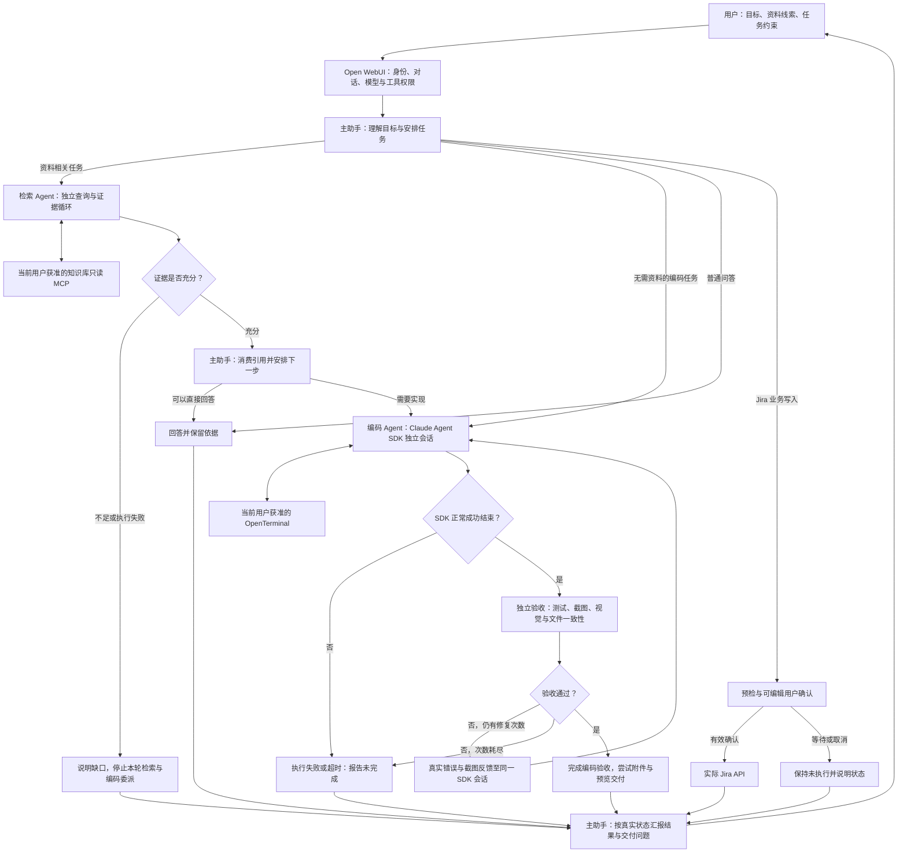
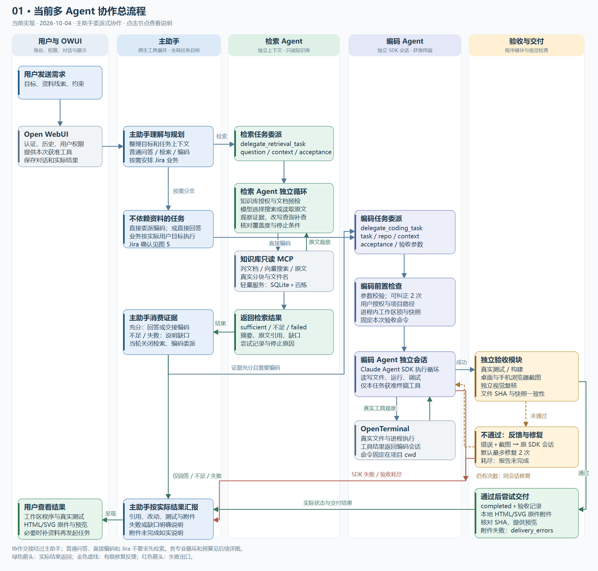
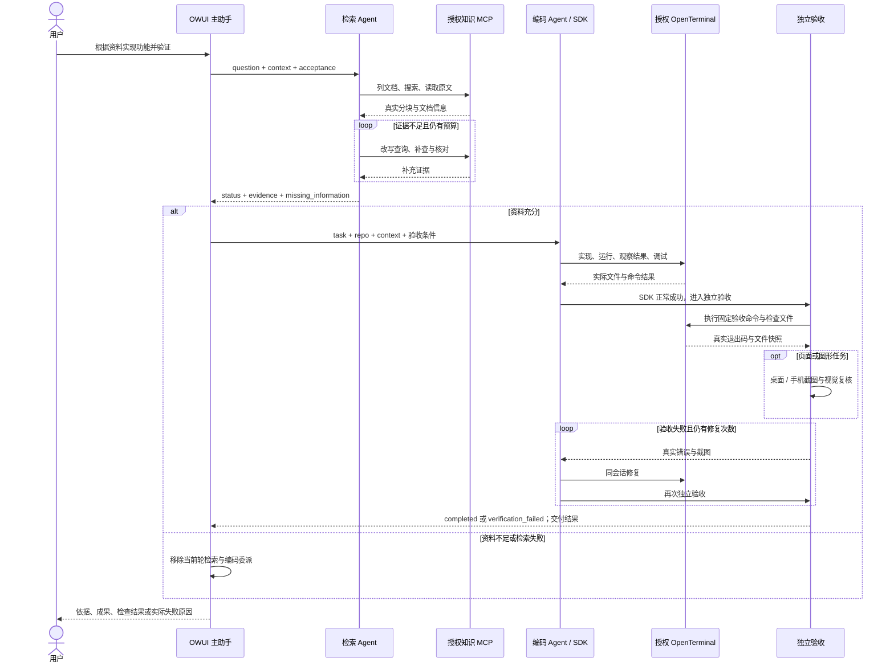
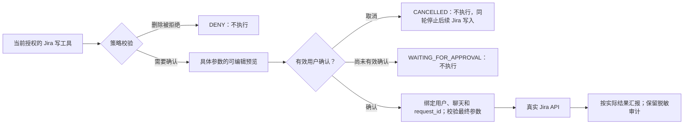

# OWUI Agent Workbench

**基于 Open WebUI 与 Claude Agent SDK 的多用户研发协作工作台。**

让用户在一个对话入口里完成“查资料 → 核对依据 → 实现代码 → 运行调试 → 独立验收 → 查看成果”，并把模型配置、工具权限、业务确认和结果展示交给平台管理。

本项目的核心是**平台控制面与 Agent 执行面分开**：Open WebUI 管理用户、对话、模型入口和授权工具；主助手统筹任务；检索与编码 Agent 分别执行专业任务；独立验收程序根据真实结果判断是否完成。

> 当前是可运行的协作平台原型。复用 Open WebUI 的多用户、分组权限和自定义模型能力，并在专业任务执行前重检授权。示例部署仍是一套终端和知识库服务，没有实现数据库级强租户隔离、每用户容器自动编排或长期后台任务续跑。

[设计理念](#设计理念) · [架构与流程](#架构与流程) · [多用户与权限设计](#多用户与权限设计) · [运行方式](#运行方式) · [当前边界与后续方向](#当前边界与后续方向)

## 产品定位

面向需要结合内部资料完成开发工作的工程师和小型团队。例如：根据规范实现参数校验程序、读取项目并修复测试失败、制作 HTML/SVG 展示页面，或在用户确认后提交 Jira 工单。

用户描述目标，平台安排任务并返回可以检查的成果：原文引用、实际文件、测试退出码、页面截图和可下载原件。检索证据不足、工具未授权或验收未通过时，系统保留实际原因，并明确说明任务没有完成。

项目主要验证三个问题：

1. 如何把专业 Agent 接入已有的多用户平台，复用模型配置和权限体系。
2. 如何让不同 Agent 的任务与结果有明确接口，交接时保留依据。
3. 如何把“模型说完成”转化为“程序实际检查通过且用户能查看成果”。

本仓库在 [tfriedel/openwebui-claude-code](https://github.com/tfriedel/openwebui-claude-code) 的 Pipe 基础上扩展，增加主助手编排、独立检索、编码验收、视觉交付与业务工具治理。上游单独 Pipe 的说明保存在 [legacy-pipe.md](docs/legacy-pipe.md)。

## 设计理念

### 1. 利用成熟平台承接多用户能力

Open WebUI 已经提供用户、对话、模型配置和工具连接等基础能力。本项目通过 Pipe 和 Tools 接入，在现有界面中呈现协作过程。

这样，用户管理和模型入口继续属于平台，Agent 只处理本次专业任务。管理员可以在 Workspace 中组织助手名称、系统提示、模型参数、可见用户或分组、知识与工具绑定，无需把这些平台能力再写进每个 Agent。相关平台能力见 [Open WebUI Models](https://docs.openwebui.com/features/workspace/models/) 和 [RBAC](https://docs.openwebui.com/features/authentication-access/rbac/)。

### 2. 自定义助手与底层模型分开

“协作助手”是一个产品入口，检索 Agent、编码 Agent 是执行角色，Claude Agent SDK 是运行框架。这三种概念分别配置。

主助手、检索和编码都有独立的 `MODEL` Valves。检索可以选较轻的模型，编码可以选更适合实现与调试的模型，视觉复核也可以单独选模型。更换底层模型时，任务接口、授权逻辑和验收程序仍然存在。

当前三个 Agent 共用后端配置的模型接口凭据；尚未实现每用户独立 API Key 或 BYOK。多用户平台能力不意味着模型调用凭据已经按租户分开。

### 3. 权限由平台与执行程序决定

模型负责选择下一步，但不能因角色名称或提示词就获得额外工具。

主助手只获得当前请求可用的委派工具与业务工具。底层知识库和终端工具从它的实际 callable 映射中移除；检索与编码 Agent 接到任务后，再依据当前 OWUI 用户检查连接权限。授权不足返回明确失败。

编码 SDK 默认禁用宿主机的 Read、Edit、Bash 等内置工具，也不加载宿主 `.claude` 设置。文件和命令操作通过 OWUI 授权的 OpenTerminal 连接执行。权限收敛落实在工具集合和调用路径上。

### 4. 以专业任务组织上下文

主助手保留全局目标和对话关系；专业 Agent 接收本次任务需要的上下文、规则和验收条件，各自维护执行循环。

这让检索专注查询与原文，编码专注实现与调试。专家返回结构化结果，主助手再决定后续步骤。当前专业 Agent 之间的交接经过主助手，没有直接互相调用或共享聊天上下文。

### 5. 检索结果要能支撑下一步

检索返回摘要之外，还保留真实文档分块、引用与缺失信息。引用需要与取回的原文匹配；充分性需要覆盖任务要求。

资料内容作为证据，不作为新的操作授权。资料没有覆盖问题时，系统指出缺口并停止当前轮的后续检索与编码委派。对无需资料的编码任务，主助手可以直接委派，不强制先检索。

### 6. 完成由独立验收决定

SDK 正常结束是进入验收的条件。完成状态还需要真实测试、实际页面和文件一致性检查通过。

验收失败时，把真实错误输出和截图反馈给同一个编码 SDK 会话，允许有限次数修复。修复使用原验收标准，不通过删除要求或吞掉退出码来标记成功。任务要求保留既有测试时，会额外核对测试文件未被修改。

### 7. 人工确认针对具体内容

业务写入的确认包含实际字段，用户可以修改 Jira 项目、标题和描述等内容。执行时使用最终确认的参数，并核对用户、聊天和请求身份。

确认成功与 Jira API 提交成功分别判断。取消、无效确认或等待确认都不能被描述为已经创建工单。

### 8. 交付要形成证据链

任务约束 → 原文依据 → 实际改动 → 测试与截图 → 验收结论 → 附件原件。

本地 HTML/SVG 的交付文件需要与浏览器验收源文件的 SHA256 一致。用户看到原件、预览和检查结果，便于判断成果是否符合目标。验收完成和附件交付完整是两个状态，附件失败会单独报告。

## 架构与流程

### 总体协作流程

下面的流程按用户目标选择分支。普通问答、直接编码和业务操作都不要求先经过知识检索。





### 三个 Agent 的职责与执行循环

| 角色 | 执行循环 | 输入与输出 | 专业工具范围 |
| --- | --- | --- | --- |
| 主助手 | OWUI 原生 server-side 工具循环 | 用户目标 → 委派任务 → 消费结果 → 下一步或汇报 | 两个委派工具，以及当前获准的业务工具 |
| 检索 Agent | 独立 AsyncAnthropic 消息与工具循环 | 问题、上下文、充分性要求 → 结论、原文引用、缺口与尝试记录 | 搜索、文档列表、原文读取三个只读知识工具 |
| 编码 Agent | 独立 Claude Agent SDK 会话 | 任务、项目目录、资料依据、验收条件 → 实际文件、执行报告与验收结果 | 当前用户获准的 OpenTerminal 文件与命令工具 |

主助手 Pipe 每次完成一次模型请求，将工具调用转换为 OWUI 可识别的 `tool_calls`。OWUI 执行工具、记录结果，然后再次请求主模型。专业 Agent 在自己的工具循环中执行专业任务，避免同一个工具动作被两个循环重复执行。

独立视觉检查是验收模块，Jira 是业务工具，它们没有独立自主的任务工具循环，不计为第四、第五个 Agent。

### 任务如何交接



这属于**主助手中心的委派式多 Agent 协作**：三个角色各有上下文、工具边界和循环。当前按调用等待结果，没有并行专家协商、Agent 消息总线或分布式任务队列。

### 五张详细流程图

总图适合介绍架构，下面的展开图适合说明每个循环的条件、预算和失败出口。点击图片可查看完整尺寸。

| 流程 | 内容 | 文件 |
| --- | --- | --- |
| 多 Agent 总流程 | 用户入口、按需路由、结果交接、工具观察、修复与汇报 | [PNG](docs/diagrams/01-multiagent-overview.png) · [SVG](docs/diagrams/01-multiagent-overview.svg) |
| 检索 Agent | 授权、索引预检、查询补查、引用校验、预算耗尽 | [PNG](docs/diagrams/02-retrieval-agent.png) · [SVG](docs/diagrams/02-retrieval-agent.svg) |
| 编码 Agent | 参数纠正、授权、工作区、SDK 工具循环、失败状态 | [PNG](docs/diagrams/03-coding-agent.png) · [SVG](docs/diagrams/03-coding-agent.svg) |
| 验收与交付 | 固定检查、浏览器、视觉复核、同会话修复、附件错误 | [PNG](docs/diagrams/04-verification-delivery.png) · [SVG](docs/diagrams/04-verification-delivery.svg) |
| Jira 确认 | 真实项目与权限、用户编辑、确认校验、取消和 API 提交 | [PNG](docs/diagrams/05-jira-confirmation.png) · [SVG](docs/diagrams/05-jira-confirmation.svg) |

[可维护 Mermaid 源码](docs/multiagent-flow-detailed.md) · [离线流程图查看器](docs/diagrams/index.html)

GitHub 文件页面不执行查看器里的 JavaScript。下载或克隆仓库后，用浏览器打开 `docs/diagrams/index.html`，可以切换五张图、缩放、全屏、点击节点查看说明。

## 多用户与权限设计

### 平台权限与专业执行权限衔接

用户在平台看见某个助手，并不等于能够使用所有工具。实际能力由模型绑定、当前用户的资源授权，以及执行时的专项检查共同决定。

| 层次 | 由谁负责 | 当前做法 |
| --- | --- | --- |
| 身份和对话 | Open WebUI | 用户登录、用户 ID、对话与当前请求上下文 |
| 助手入口 | Open WebUI Workspace Model | 名称、提示、工具绑定、参数和用户/分组可见性配置 |
| 请求工具集合 | OWUI 与主助手 Pipe | 只消费平台提供的 callable；移除主助手不应直接使用的底层工具 |
| 知识库访问 | 检索工具 | 根据当前用户重新检查 MCP 连接 ACL，只允许三个读取工具 |
| 终端访问 | 编码工具 | 通过 OWUI 终端工具解析当前用户授权，拒绝无连接权限的请求 |
| SDK 宿主能力 | 编码运行框架 | 禁用默认宿主文件和命令工具，不加载宿主 settings |
| 项目操作边界 | 编码工具与终端适配 | 核对真实项目目录、部分写路径约束；命令固定项目 cwd |
| 业务写入 | 治理中间件 | YAML 策略、具体字段确认、绑定用户与请求、脱敏审计 |

Open WebUI 的角色、分组和资源 ACL 负责平台资源共享。配置时要考虑其权限具有叠加关系；来自不同分组的授权可能合并，不能把加入另一组理解成自动撤销权限。参见 [官方权限说明](https://docs.openwebui.com/features/authentication-access/rbac/)。

### 多租户设计如何落地

本项目采用分层路线：先复用平台多用户和资源授权，再在专业任务执行处校验权限，随后扩展数据与运行环境的租户边界。

当前示例：

- OpenTerminal 登记到配置的所属用户，授权使用不可变的 OWUI 用户 ID。
- 知识库 MCP 默认授权给协作助手所属用户。
- 交付附件保存到当前用户的 OWUI 文件存储，预览再次检查文件所属用户。
- 同一终端连接的编码任务通过进程内锁串行，减少同时修改工作区的冲突。

当前 Compose 仍只有一个终端卷和一个轻量知识库 SQLite。知识库没有逐文档用户归属和租户 ACL，天气/Jira 登记模板也需要管理员补充实际资源授权。不能直接将当前实验配置开放给所有用户，然后认为数据和执行环境已经完全隔离。

要支持更完整的多租户部署，需要继续实现每用户或项目的终端实例、独立工作区与凭据、知识库 tenant ID 和文档 ACL、配额与审计，以及跨实例并发控制。这些是设计延伸，尚未全部实现。

### 多模型与助手自定义

| 配置对象 | 当前入口 | 用途 |
| --- | --- | --- |
| 面向用户的助手 | Workspace Model `owui-main` | 展示“协作助手”，绑定委派与业务工具，使用 native 工具调用 |
| 主助手模型 | Functions → `owui-main` → Valves → `MODEL` | 规划、协调、业务工具选择 |
| 检索模型 | Tools → `retrieval_agent` → Valves → `MODEL` | 查询设计、证据核对与结构化结论 |
| 编码模型 | Tools → `coding_agent` → Valves → `MODEL` | 实现、运行与调试 |
| 视觉模型 | `coding_agent` → `VISUAL_REVIEW_MODEL` | 图片输入与任务要求复核；留空继承编码模型 |

初次注册三个角色默认继承环境中的模型 ID；已有 Valves 保存值优先，修改 `.env` 不会自动覆盖它们。示例验证曾使用 Qwen Plus/Flash 分配不同职责，但模型名称和能力以实际服务商配置为准。

当前模型接口需要支持 **Anthropic Messages 与工具调用**。只支持 OpenAI Chat Completions 的地址不能直接当作编码 SDK 的端点。第三方兼容接口需要验证工具参数、返回消息、会话连续性和图片输入，不能只依据“兼容 API”标签判断可用。

## 专业 Agent 与验收闭环

### 检索：带停止条件的证据循环

接口为 `delegate_retrieval_task(question, context, acceptance)`。

先检查当前用户是否获准连接知识库，再检查文档列表和有效向量索引。模型选择搜索或读取原文，观察证据后决定补查还是输出结论。重复查询会受到抑制。

默认预算为 **6 轮模型请求、3 次搜索、8 次工具调用、120 秒**。最终格式与引用错误最多纠正 2 次，仍计入模型总轮次预算。模型最终状态允许 `sufficient` 或 `insufficient_evidence`；连接、授权、模型故障或超时的 `failed` 由执行程序产生。

返回结果包含结论、真实引用、缺失信息、尝试记录和停止原因。资料不足或执行失败时，当前用户轮的检索与编码委派被关闭；下一次用户消息重新评估。

实现与设计：[retrieval_tool.py](supervisor/retrieval_tool.py) · [检索 Agent 设计](docs/retrieval-agent-design.md)。

### 编码：Claude Agent SDK 负责自主执行

接口为 `delegate_coding_task`，接收任务、项目目录、必要上下文、验收条件、验收命令和预览目标等参数。

执行前完成参数检查、用户授权、项目目录确认、工作区锁和初始文件快照。参数错误返回 `invalid_arguments`、`execution_started=false` 和纠正信息，主助手可以最多纠正 2 次；它不会提前启动 SDK，也不占用验收修复次数。

编码模型在独立 `ClaudeSDKClient` 会话里选择工具、观察运行结果、修改代码、执行测试并继续调试。这种自主执行能力来自 SDK 工具循环，而工具范围来自 OWUI 授权桥。SDK 使用方式参见 [官方 Python SDK](https://github.com/anthropics/claude-agent-sdk-python)。

默认每次 SDK query 的 `MAX_TURNS=20`。600 秒超时覆盖 SDK 执行、独立验收和验收后的修复，工作区排队、授权与预检不在这段超时内。SDK 自身异常或超时直接返回失败，验收修复循环针对正常结束后的验收问题。

实现与设计：[coding_tool.py](supervisor/coding_tool.py) · [运行结构](docs/harness-design.md)。

### 验收：读取真实结果，再决定完成

独立验收检查：

1. 实际改动与任务约束：只读任务不得修改文件，未解决问题不能被忽略；要求保留测试时核对原测试未改。
2. 预先固定的真实命令：退出码非零或空测试集不能通过，禁止用吞掉错误的命令替代检查。
3. 页面与图形：浏览器真实渲染，检查加载错误、空白和溢出，取得桌面两帧及手机一帧。
4. 独立视觉复核：根据截图、任务和验收条件判断主体、布局、裁切等问题；无效输出或服务失败视为未通过。
5. 文件一致性：本地预览源 SHA 与验收快照一致，验收前后实际文件没有再次变化。

检查按任务类型选择：纯 HTML/SVG 可以使用浏览器验收；只读分析和文档任务根据实际目标选择检查。不是每个任务都自动运行整个工作区的无关测试集，也不能把前端测试和视觉检查互相替代。

默认 **1 次初始验收 + 最多 2 次修复 = 最多 3 次验收**。失败反馈使用真实输出和截图，回到同一个 SDK client。次数耗尽返回 `verification_failed` 并报告未完成。

实现与设计：[verification.py](supervisor/verification.py) · [浏览器服务](verification_browser/server.py) · [验收说明](docs/coding-verification.md)。

### 交付：原件、预览与状态分别核对

验收通过后，对本地 HTML/SVG 尝试保存原件、预览与截图。SVG 原件保持 `image/svg+xml`，另生成可见图片预览；交付字节与已验收源 SHA256 比对。普通代码主要保存在工作区，当前没有对所有文件格式自动生成下载附件。

| 状态 | 含义 | 主助手如何汇报 |
| --- | --- | --- |
| `invalid_arguments` | 参数尚未合法，SDK 没有执行 | 按纠正信息调整；超过上限说明未完成 |
| `failed` | 授权、执行、模型调用或超时失败 | 保留实际原因与已有改动，停止绕过失败重复委派 |
| `verification_failed` | 独立检查未通过且修复次数耗尽 | 展示检查问题，说明未完成 |
| `completed` | SDK 正常成功且独立验收通过 | 展示改动、真实检查与可用成果 |
| `delivery_errors` | 验收之后的附件或预览交付有问题 | 明确附件交付未完整，不伪造预览 |

`delivery_errors` 目前不会自动把 `completed` 改成失败，也没有自动交付重试循环。用户应同时核对验收结论和交付结果。

实现与设计：[artifacts.py](supervisor/artifacts.py) · [交付流程](docs/coding-delivery-flow.md)。

## 业务工具治理：以 Jira 为例

Jira 仍由主助手使用，不交给编码 Agent。创建前读取真实项目、创建权限与可用工单类型；多项目尚未指定时请用户选择，不从资料编号外观猜测工单。

受治理写工具经过如下链路：



确认绑定当前用户、聊天与请求，编辑后的字段成为实际提交参数。创建时还会再次核验权限与类型。背景点击保留草稿；关闭、取消或 Escape 返回取消状态。

SQLite 保存待确认请求、幂等标识与脱敏审计。当前强制确认覆盖配置中的 Jira 写工具，不代表所有 shell、Git 或发布动作都已经接入同一强制审批门。旧的群组管理员审批路径属于保留设计，不是当前默认演示流程。

相关实现：[governance](governance/) · [策略](policies/) · [确认界面](frontend/README.md)。

## 技术选型

| 层次 | 技术 | 选择原因与当前用途 |
| --- | --- | --- |
| 平台 | Open WebUI v0.11.4-slim | 复用身份、对话、模型入口和工具配置；固定版本便于匹配前端确认补丁 |
| 编排 | Python Pipe / Tools | 主助手接入 OWUI 原生循环，专家以任务接口接入 |
| 检索推理 | AsyncAnthropic | 独立消息与工具循环，显式控制预算、证据与停止条件 |
| 编码执行 | Claude Agent SDK、Claude Code CLI | 复用自主工具循环和同会话调试；模型与授权工具单独配置 |
| 工具协议 | OWUI MCP / OpenAPI、进程内 MCP 桥 | 复用平台现有连接和 callable，不复制一套业务权限来源 |
| 终端 | OpenTerminal | 隔离于 OWUI 后端的文件与进程执行服务，持久化工作区 |
| 知识服务 | Python、SQLite、向量相似度、百炼 embedding | 轻量部署、保留文档分块和来源，验证证据交接 |
| 页面检查 | FastAPI、Playwright 1.63.0、Chromium | 独立浏览器服务，只读挂载工作区，取得真实截图 |
| 治理 | YAML、Python 中间件、SQLite | 显式策略、确认状态、幂等与脱敏审计 |
| 部署 | Docker Compose、持久化 volumes | 清晰服务边界，保持实验环境可运行和可检查 |

知识服务在本地名为 `ragflow`，是本项目的轻量实现，**不是官方 RAGFlow 产品**。当前采用向量搜索与原文分块，没有知识图谱、OCR、混合检索或重排。

`anthropic-proxy/`、`sandbox/` 和独立 Pipe 是保留的上游路径；`runtime/` 包含其他终端传输实现。它们不是当前三 Agent 主流程中的必要新增服务。

## 运行方式

### 环境与配置

需要 Git、Docker 和 Docker Compose。SDK、CLI 和应用 Python 依赖在容器镜像中安装，宿主无需额外安装 Claude Code。

```bash
git clone https://github.com/absh25/owui-agent-workbench.git
cd owui-agent-workbench/lab
```

复制 `.env.example` 为 `.env`，然后填入实际模型接口、API Key、随机密钥和终端所属用户。PowerShell：

```powershell
Copy-Item .env.example .env
```

Linux/macOS：

```bash
cp .env.example .env
```

主要配置：

| 变量 | 用途 |
| --- | --- |
| `UPSTREAM_API_BASE`、`UPSTREAM_API_KEY`、`UPSTREAM_MODEL` | Anthropic Messages 兼容模型接口；主助手及专家初次注册的基础配置 |
| `WEBUI_SECRET_KEY` | OWUI 服务随机密钥 |
| `OPEN_TERMINAL_API_KEY` | 终端服务认证；与其 OWUI 连接使用相同值 |
| `OPEN_TERMINAL_OWNER_NAME` | 终端所属 OWUI 用户的显示名，需与实际账号一致 |
| `RAGFLOW_MCP_TOKEN` | 只读知识 MCP 认证 |
| `RAGFLOW_DASHSCOPE_API_KEY` | 百炼 embedding 密钥 |
| `JIRA_BASE_URL`、`JIRA_EMAIL`、`JIRA_API_TOKEN` | 可选 Jira 业务配置 |

不要使用示例占位密钥启动共享部署。`.env`、数据库、日志、浏览器缓存和本地输出目录已排除 Git；公开流程图单独存放于 `docs/diagrams/`。

### 构建与启动

知识库镜像依赖本地构建的 OWUI 镜像，首次先构建 OWUI，再启动完整服务：

```bash
docker compose build open-webui
docker compose up -d --build --wait
docker compose ps
```

浏览器打开 [http://127.0.0.1:13000](http://127.0.0.1:13000)，创建首个管理员账号。显示名应与 `OPEN_TERMINAL_OWNER_NAME` 一致。

Compose 不自动登记协作入口与工具。创建账号后执行：

```bash
docker compose exec -T open-webui python /lab/register_open_terminal.py
docker compose exec -T open-webui python /lab/supervisor/register.py
docker compose exec -T open-webui python /lab/retrieval_lab/register.py
docker compose restart open-webui
```

登记程序保留备份，安装 `owui-main` 与两个专业工具。它也会迁移和清理两个已知的旧实验入口；建议用本项目独立 Compose 实例试运行，不把实验登记步骤直接用于已有生产实例。

刷新页面，选择 **协作助手**。知识检索前，在 [http://127.0.0.1:18004](http://127.0.0.1:18004) 上传资料并完成向量化。

### 可选业务连接

Jira 不使用时无需登记业务连接。配置实际凭据后：

```bash
docker compose exec -T open-webui python /lab/register_jira_mcp.py
```

天气登记脚本未默认挂载，先复制再运行：

```bash
docker compose cp ./register_weather_mcp.py open-webui:/tmp/register_weather_mcp.py
docker compose exec -T open-webui python /tmp/register_weather_mcp.py
docker compose restart open-webui
```

登记后，在 OWUI 中核对连接 grants、模型绑定和可见用户。当前没有 Compose profiles；Jira“可选”指是否配置和登记业务连接，默认服务清单仍包含它。

### 服务入口与数据

| 服务 | 入口 | 持久化与边界 |
| --- | --- | --- |
| Open WebUI | `127.0.0.1:13000` | 用户、对话、模型、文件与治理数据库 |
| OpenTerminal | `127.0.0.1:18002` | 示例工作区 named volume |
| 轻量知识库 | `127.0.0.1:18004` | 文档、分块与向量 SQLite |
| 天气 MCP | `127.0.0.1:18001/mcp` | 只读业务工具示例 |
| Jira MCP | `127.0.0.1:18003/mcp` | 外部业务账号与实际 API |
| 验收浏览器 | 容器网络 `verification-browser:8088` | 只读挂载终端工作区，未暴露宿主端口 |

当前示例工作区固定为 `/workspace/wenguang.wu`。修改终端所属用户名称只改变授权对象，不自动创建或重命名工作区。为另一用户或项目部署时，需要配置相应终端服务、卷、浏览器挂载和连接授权。

TCP 健康检查通过不等于 Jira 鉴权成功；知识库健康通过也不代表 embedding 密钥已配置。OWUI 镜像与确认补丁绑定 v0.11.4，升级版本时需重新验证前端和平台接口。

## 体验任务与验证

### 三个典型任务

**资料驱动开发**：先上传带明确规则的演示文档，再要求“检索原文并给出引用，证据足够后实现参数校验函数及测试，运行并展示实际结果”。资料应标注为演示数据，避免把样例参数描述成真实设备规范。

**自主调试**：准备失败实现和固定测试，要求修复实现、保持原测试、运行验证。重点观察真实退出码由失败变为成功，以及最终独立验收。

**视觉交付**：要求创建猫咪 SVG 或简单 HTML，指定主体、尺寸与显示要求，检查桌面和手机截图、原件附件与可见预览。

### 回归与实测的区别

回归测试验证授权、工具桥、参数纠正、引用校验、确认、独立验收和交付状态等程序行为。真实 Agent 实测则调用实际模型和终端，验证执行链；二者不能互相替代。

后端重点回归：

```bash
docker compose exec -T open-webui python -m unittest tests.test_supervisor tests.test_retrieval_agent tests.test_user_confirmation tests.test_supervisor_registration tests.test_coding_verification tests.test_visual_delivery tests.test_tool_middleware
docker compose exec -T retrieval-lab python -m unittest -q tests.test_retrieval_lab
docker compose exec -T open-webui python -m unittest discover -s /opt/owui-jira-review -p test_patch_frontend.py
```

知识库 PDF 与备用 runtime transport 测试有各自依赖，不能在未安装这些依赖、未挂载对应包的 OWUI 容器里直接把全部 discover 当成完整验证。发布前分组执行记录见 [发布核验](docs/publishing-checks.md)。

已有真实调试脚本会创建独立失败样例、调用模型、检查实现修改、独立重跑固定测试，**会消耗模型额度**：

```bash
docker compose exec -T -e PYTHONPATH=/lab:/app/backend open-webui python /lab/supervisor/smoke_coding_debug.py
```

Jira 写入测试不要随意批准真实请求。部分历史诊断脚本绑定已有工作区或截图 ID，它们保留用于解释排查过程，不属于全新部署即可运行的通用 smoke。

## 代码与设计文档

```text
supervisor/             主助手、检索和编码任务接口、独立验收、附件交付
governance/             策略执行、确认、幂等与脱敏审计
policies/               工具策略和 Jira 工作流
retrieval_lab/          轻量知识库、embedding 与只读 MCP
verification_browser/  真实浏览器截图服务
frontend/               Jira 可编辑确认界面及补丁安装器
runtime/                其他终端传输实现
lab/                    Compose、镜像构建、连接登记与实测脚本
tests/                  后端回归
docs/diagrams/          五张详细流程图、离线查看器与节点说明
docs/                   架构、检索、验收、交付与迭代记录
sandbox/                上游保留的独立 sandbox 路径
```

| 文档 | 重点 |
| --- | --- |
| [三 Agent 运行结构](docs/harness-design.md) | 循环归属、委派方式和当前实现 |
| [检索 Agent 设计](docs/retrieval-agent-design.md) | 证据检查、补查与停止条件 |
| [知识服务设计](docs/retrieval-lab.md) | 文档、embedding 与只读 MCP |
| [编码验收](docs/coding-verification.md) | 完成判定、真实测试、视觉与修复 |
| [交付流程](docs/coding-delivery-flow.md) | 原件、用户文件、预览与一致性 |
| [完整细化流程](docs/multiagent-flow-detailed.md) | 参数纠错、预算、失败与交接 |
| [协作迭代记录](docs/collaboration-update.md) | 已发现问题、修复设计和历史实测 |
| [记忆与运行审计](docs/memory-and-runtime-audit.md) | OWUI 与 SDK 的上下文边界 |
| [前端确认补丁](frontend/README.md) | 可编辑确认与固定版本部署 |

## 迭代路线

| 阶段 | 解决的问题 | 设计结果 |
| --- | --- | --- |
| 1. 接入平台 | 把编码循环接入 OWUI 对话和授权工具 | Pipe、SDK 工具桥和平台工具复用 |
| 2. 分出专业角色 | 查资料与编码混在单一上下文 | 主助手统筹、独立检索与编码委派 |
| 3. 约束证据 | 有检索结果但缺少原文覆盖 | 引用校验、预算、缺失信息与不足停止 |
| 4. 完成验收 | SDK 正常结束被误当成任务完成 | 固定测试、浏览器截图、视觉与快照检查 |
| 5. 修复与交付 | 参数错误被误判为执行失败；SVG 用户不可见 | 分离纠错预算、同会话修复、原件预览和 SHA 校验 |
| 6. 业务治理 | 确认内容与实际提交字段可能不同 | 可编辑预览、用户请求绑定和实际参数执行 |

历史验证记录用于说明这些改动的依据，不是成功率统计。当前尚未给出大规模任务集的成功率、并发能力或成本基准。

## 当前边界与后续方向

| 当前边界 | 后续方向 |
| --- | --- |
| 单终端卷、单知识库实例，没有强数据租户隔离 | 按用户/项目编排终端、知识 tenant ID 与文档 ACL |
| 三角色独立模型但共用后端模型凭据 | 凭据分配、租户预算和成本归属 |
| 终端锁是进程内锁 | 跨实例锁、任务队列、持久状态和重启续跑 |
| 专家交接通过主助手，按调用等待 | 并行任务与独立产物合并，避免共享写冲突 |
| 路径校验不等于任意 shell 完全隔离 | 执行层隔离、资源/网络策略和更完整命令治理 |
| Jira 写入有强制确认，其他工具按现有配置执行 | 统一高影响操作的确认与策略范围 |
| 截图与视觉模型可发现明显错误，不能保证美感或交互正确 | 页面行为测试、固定视觉案例集与人工抽查 |
| 附件交付失败单独返回，无自动重试 | 交付状态机、幂等重试与可恢复文件任务 |
| 知识检索为轻量向量与原文分块 | 混合检索、重排、OCR 与检索质量评估 |

## 来源与许可说明

- 本项目基于 [tfriedel/openwebui-claude-code](https://github.com/tfriedel/openwebui-claude-code) 扩展，保留上游 Git 历史及 Pipe、sandbox 等代码来源。
- 上游 README 声明 MIT，但当前基础快照没有独立 LICENSE 文件；本仓库不补写未经核实的上游版权人声明。来源范围见 [NOTICE.md](NOTICE.md)。
- Open WebUI、Claude Agent SDK、OpenTerminal、Playwright 与其他依赖分别遵循其自身许可和使用条款。本仓库没有重新许可这些上游组件。

设计与发布说明核对日期：2026-10-04。
