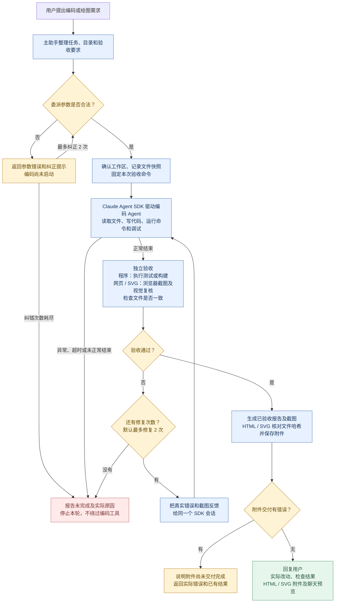

# 当前编码与绘图流程

按 2026-10-04 当前实现核对。主助手负责委派，编码 Agent 负责实际执行，独立验收负责判断是否通过。

参数纠错与编码后的修复分别计数：参数最多纠正 2 次；验收失败默认最多修复 2 次，即最多 3 轮验收。SDK 执行异常不进入验收修复循环。

前端项目可能同时需要测试和截图。纯 HTML/SVG 绘图使用浏览器和视觉验收，不用 test、ls、echo 替代验收。纯分析与文档任务按实际要求检查，不强制运行代码测试。

自动附件主要针对 HTML/SVG。验收通过与附件交付是两个步骤：附件失败记录 delivery_errors 并说明交付未完成，当前不会自动回到修复循环，编码报告状态也可能仍为 completed。
