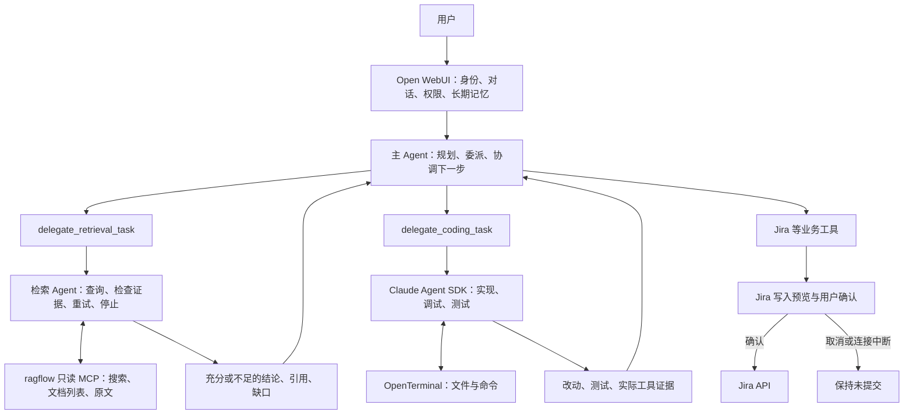

# 当前三 Agent 运行结构（2026-10-03）

刷新 OWUI 页面后，选择 **协作助手**（`owui-main`）新建对话进入主流程：
OWUI 负责规划和业务编排，
检索 Agent 管理查资料的全过程，Claude Agent SDK 管理编码全过程。
两个专业 Agent 以任务工具接入主助手，各自运行独立的模型与工具循环。
目前只保留一个 Pipe：函数与模型共用 `owui-main`，模型 `base_model_id` 为空，
直接路由到同名原生 Pipe。注册时先备份与验证委派工具，再删除已知的两个旧 Pipe
及对应模型。旧 `owui_supervisor` 对话只迁移模型元数据，正文保持不变；
旧 Claude 对话记录仍保留。重复注册无需旧 Pipe，也不会恢复它们。



## 三个循环的职责

| Agent | 执行循环 | 负责的事情 | 专业工具 |
| --- | --- | --- | --- |
| OWUI 主 Agent | OWUI 原生 server-side 工具循环 | 理解目标、拆分任务、委派、结合结果安排下一步、汇报 | 两个委派工具、Jira 等业务工具 |
| 检索 Agent | 独立 AsyncAnthropic 模型与工具循环 | 设计查询、核对原文覆盖度、改写查询、判断充分性与停止条件 | 当前用户授权的三个 ragflow 只读 MCP 工具 |
| 编码 Agent | Claude Agent SDK 循环 | 读代码、实现、调试、运行测试、根据反馈继续处理 | 当前用户授权的 OpenTerminal 工具 |

`supervisor/native_pipe.py` 每次只调用一次 Messages API，将结果转换为 OWUI
能识别的流式文本或 OpenAI 格式的 `tool_calls`。OWUI 原生循环负责执行工具、保存结果
并再次请求主模型。主助手看不到底层 ragflow 检索工具或终端工具；需要这些能力时，
通过相应委派接口交给专业 Agent。普通业务任务继续使用已授权的 OWUI 工具。

模型根据目标决定任务顺序，没有关键词分类器、后台任务队列或新的业务状态库。
当前委派按调用等待结果，不提供多个专业 Agent 同时操作同一任务的协作消息总线。

任务来源优先于编号外观：用户说明要查 ragflow、知识库或资料时，`SS-TEST-042` 等编号
作为资料线索交给检索 Agent；不能因为形似工单号就查 Jira。检索工具缺失时明确报告配置
或授权问题，不使用 Jira 作为后备检索。只有用户明确要求 Jira 任务时才走 Jira 工具。

## 检索 Agent

`delegate_retrieval_task(question, context="", acceptance="")` 接收明确的检索问题、
必要上下文和验收要求。Agent 在现有 OWUI 后端中运行独立推理循环，使用 OWUI 当前用户
已授权的 ragflow MCP 连接；不复制凭据、不绕过用户权限，也不增加新容器。

先检查文档列表和当前向量索引；没有可用索引就返回证据不足。随后模型选择搜索或读原文，
观察结果后判断是否覆盖问题。证据不足时可改写查询继续检索；重复查询被抑制，
默认上限为 6 轮模型请求、3 次搜索、8 次工具调用、120 秒。

最终返回 `sufficient`、`insufficient_evidence` 或 `failed`，同时包含摘要、真实原文证据、
停止原因、尝试记录和缺失信息。引用只能来自实际工具返回的分块；相似度与模型充分性判断
都不是科学结论认证。当前不接入知识图谱、混合检索或重排模型。

最终格式或引用无效时，会把真实分块及校验问题反馈给检索模型，最多修正两次，
仍计入原有模型轮数；摘录必须逐字匹配原文。原文读取每次最多 6 个片段。

底层 ragflow 服务负责上传、分块、百炼向量化及 SQLite 检索；检索 Agent 管理查资料的策略。
详见[检索 Agent 设计](retrieval-agent-design.md)及[知识库使用说明](retrieval-lab.md)。

## 编码 Agent

`supervisor/coding_tool.py` 通过 OWUI 的 `get_terminal_tools` 再检查用户对终端
连接的权限，再将终端工具子集交给 Claude Agent SDK。SDK 接收单次任务上下文，
没有整个业务聊天、Jira 写工具或检索平台管理权限。结果包含摘要、改动文件、测试报告
和实际工具证据。编码 Agent 内部管理实现、调试与测试；当前未配置独立审查子 Agent。

项目目录必须位于当前终端工作区，启动前检查目录存在且没有符号链接越界。
单个后端进程内的工作区锁避免两个编码任务同时操作同一终端。工作区是 OpenTerminal
内的项目，而非 Windows 宿主目录；宿主项目需要先复制或挂载进去。

主助手与编码工具当前使用 `qwen3.7-plus`，检索工具使用 `qwen3.7-flash`。
Claude Agent SDK 是运行框架，不代表使用 Claude 模型。编码工具可在单次任务中运行测试、
读取真实错误输出、修改实现并重新测试；默认最多 20 轮、600 秒，不是仅生成代码。
主助手、检索工具、编码工具的 `MODEL` Valves 可以分别配置，上游地址与凭据仍由本地
OWUI 环境提供。编码文件操作通过已有 OpenTerminal 工具执行，SDK 原生 Read/Edit/Bash
和远程 CLI transport 未启用。

## 从资料到代码的一次完整任务

例如：“查资料里的 SS-TEST-042 参数，写一个读取这些参数的函数并测试，不提交。”

1. OWUI 主 Agent 委派检索问题及所需参数给检索 Agent。
2. 检索 Agent 自己搜索、检查原文、按需补查，返回参数、引用和充分性结论。
3. 主 Agent 判断能否继续；缺少关键条件时报告缺口，不将猜测当成依据。
4. 主 Agent 将目标、检索依据、目录和验收标准交给编码 Agent。
5. 编码 Agent 修改并测试，返回实际执行结果；主 Agent 汇总给用户。

业务提交仍由主 Agent 按用户目标安排。Jira 写入先展示确定内容，再等待用户确认。
创建工单前用 `get_jira_create_context` 查询实际项目，再检查目标项目创建权限和可用工单类型；
不猜测示例项目 Key。创建客户端会复核元数据并用实际类型 ID 提交，兼容中文类型名称。
确认、取消或无效确认后及时结束等待状态，确认完成与工单创建成功分别判定。
确认弹窗支持编辑最终字段，绑定本次请求并原子保存后执行；成功结果的
`submitted_arguments` 表明用户实际确认的参数。详见[本轮改动](collaboration-update.md)。

若本用户轮实际检索结果为证据不足或失败，主助手从当前执行工具映射中移除编码委派和
再次检索委派，报告缺口并结束这条链；检索重试已由专业 Agent 在内部管理。
下一用户轮会重新评估，不把上一轮失败变成永久禁用。

## 授权、提交与状态边界

原生主助手在 OWUI 执行前包装实际 callable，共用既有 Jira 治理与确认流程。
用户取消后，同一轮改参数重试仍不能提交；模型说“用户已同意”不构成授权。
资料内容作为不可信证据处理，其中的指令不能成为工具执行授权。

SDK 编码任务默认不 commit、不 push、不发布；`needs_approval` 是提示，
还没有 Git、任意 shell、发布或合并操作的统一强制审批门。既有强制确认覆盖治理开启的
旧 Claude Pipe 和新主助手的 Jira 写工具。

每次工具执行只由所属循环完成一次。专业 Agent 已执行的底层调用返回结果与证据，
不会再次交给 OWUI 重复执行。对话、身份、工具连接和长期记忆仍以 OWUI 为准；
专业 Agent 保留任务期间的短期上下文。初版不提供后台执行、跨实例锁或重启续跑。

## 原有 Claude Code Pipe 源码

旧 **Claude Code** 入口已从当前实验注册表移除。原 `claude_agent_pipe.py` 实现将当前请求的授权 OWUI
工具转换为进程内 MCP，再交给 SDK 循环执行；它不是上述三 Agent 主流程。
`TOOL_MODE=owui_only` 默认不开放 Claude Code 自带的宿主 Read/Edit/Bash。
无授权操作工具的聊天走直接 Messages API。旧模式的身份、权限及 Jira 确认仍由 OWUI
和治理中间件维护，不能将两条入口混同为两个同时运行的主 Agent。

## 同步与验证

在 `lab` 目录执行：

```powershell
docker compose exec -T open-webui python /lab/supervisor/register.py
# 等注册命令完整退出后，再刷新后端缓存。
docker compose restart open-webui
docker compose exec -T open-webui python /lab/supervisor/smoke_agents.py
```

本轮 90 项回归测试全部通过，其中检索 Agent 与主助手 43 项（33 + 10）。
本轮实时测试从 `/api/models` 读取各入口实际完整工具配置，包含 Jira 等业务工具。
主入口按顺序调用 `delegate_retrieval_task` 和
`delegate_coding_task`；检索返回充分并给出真实原文，编码任务收到文件名、参数与演示限制，
生成实现和测试后完成。OpenTerminal 独立重跑两项测试通过，并确认采样率 `2e6`、
阈值 `0.12`、`IS_DEMO=True`。
示例只将演示参数保存为常量，用于验证跨 Agent 证据传递，不是实际频谱感知算法实现。

真实负向验证中，检索指出缺少通用计算公式与真实性能依据，主助手只调用检索委派，
随后报告缺口停止，没有进入编码。上述验证没有 commit、push 或 Jira 写入。

清理前的 `owui_supervisor` 知识库路由也通过验证：只调用检索委派，返回准确演示参数
和真实原文引用，没有 Jira 调用。主入口 `owui-main` 的正向交接与不足停止均通过，
正向检索使用 3 轮模型请求、1 次搜索、3 次工具调用。工具配置以实际模型设置为准，
验证没有手动缩减为两个委派工具。

可在 **协作助手** 复制：

```text
查 ragflow 中 SS-TEST-042 的采样率和阈值并附原文引用。证据足够后，
委派编码 Agent 在当前工作区新目录生成演示参数模块、标记演示数据，
写至少两个单元测试并运行，不提交。
```
