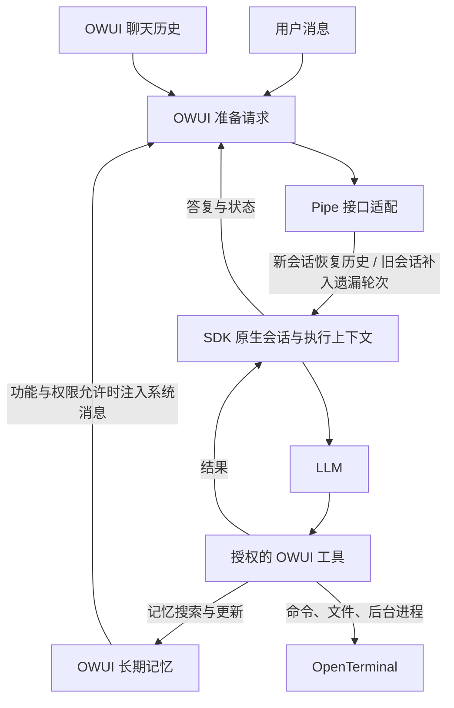

# 记忆与运行链路检查（2026-10-02）

## 检查结论

当前组合是 Open WebUI 0.11.4、Claude Agent SDK、DeepSeek-V4-Flash、
OpenTerminal 和请求级 OWUI 工具桥接。职责划分可行，但原有记忆衔接存在遗漏。

| 问题 | 已确认的证据 | 本次处理 |
| --- | --- | --- |
| 新 SDK 会话缺少已有历史 | 原 Agent 路径只提取最后一条用户消息；没有恢复 OWUI 的历史消息 | 新会话从 OWUI 请求补入最近的历史文本，上限约 24,000 字符 |
| 普通聊天未进入 SDK 上下文 | 问候、能力询问、无工具聊天走 Messages API | 保留 SDK 会话，并在下次 Agent 请求补入其尚未接收的用户轮次 |
| 会话隔离不足 | 会话字典只按 chat_id 索引，缺失 chat_id 使用共享 default | 用用户 ID + chat_id 的哈希隔离会话和运行目录；缺失 ID 时不共享默认会话 |
| 原生记忆工具被过滤 | OWUI_BUILTIN_TOOLS 默认空字符串 | 默认恢复八个 OWUI 记忆工具，只有 OWUI 已在本次请求授权的工具才能进入桥接 |
| 失败会话可能继续恢复 | 部分错误/空白结束没有清理 session_id | 超时、取消、错误和无效答复清理会话索引 |
| 工具前文字流可无限延长等待 | 原保护只限制连续无事件，工具后保护不覆盖工具前 | 增加工具前模型等待上限，默认 45 秒，不因文字事件重置 |
| 当前上游拒绝请求 | 合成工具对照测试的直接接口返回 HTTP 402、code 30001、余额不足 | 明确中文错误提示；余额问题需用户在上游账户处理 |

余额不足是在本次检查时确认的，不能由此解释所有历史慢请求。
此前正常、空白和长时间不结束的请求仍需在接口恢复后做受控对照测试。
`unrecognized_model` 是诊断线索，不是已确认的错误根因。

## 记忆的职责与实际路径

短期工具结果、执行对话及工作状态留在 SDK 会话中；OWUI 管理长期记忆的
存储、检索、权限和已有记忆审查逻辑。本次没有增加独立的长期记忆数据库。

容器实际配置中 `memories.enable` 和 `memories.system_context.enable` 均为 true。
OWUI 源码还要求本次请求 `features.memory` 为 true，以及用户权限和模型配置允许。
总开关开启不代表每个聊天都启用了记忆。

SDK 会话索引目前仍在后端进程内存中。后端重启后，可以从 OWUI 的历史文本
恢复对话背景，但不能声称恢复了此前 SDK 的全部工具轨迹和未完成工作状态。
普通聊天切换后的增量补入基于用户轮次数；编辑历史或切换对话分支的完整一致性
尚未建立专门的消息版本索引。

## 对引入 Claude Agent 的评价

采用 SDK 是为了复用执行循环、原生会话、hooks 和扩展能力，而不是因为
换一个 Agent 名称就会提高模型能力。OWUI 工具和长期记忆不必随之替换。

如果主模型主要是 DeepSeek，任务主要是调用 OWUI 工具，并且没有使用
Claude SDK 的特有能力，直接维护 OWUI 原生执行循环会减少协议与状态适配。
如果需要 SDK 的执行能力，则保留这个方案是合理的，但必须验证模型协议兼容性，
明确上下文归属，并保证一轮操作只由一个执行循环负责。

本次保留现有 SDK 架构，没有擅自替换为 OWUI 原生执行器。

## 验证和限制

自动测试覆盖：首次恢复历史、原生会话继续、普通聊天后的增量同步、长期记忆
系统消息透传、原生记忆工具桥接、用户/聊天隔离、持续流式事件下的超时及工具不重放。
余额不足导致当前真实模型的完整对照测试无法继续；没有声称接口兼容性已完全修复。
