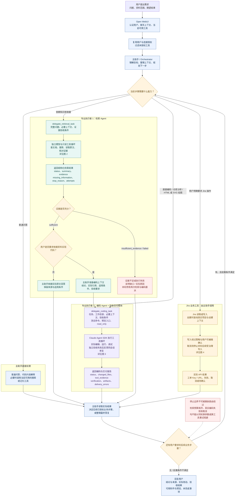
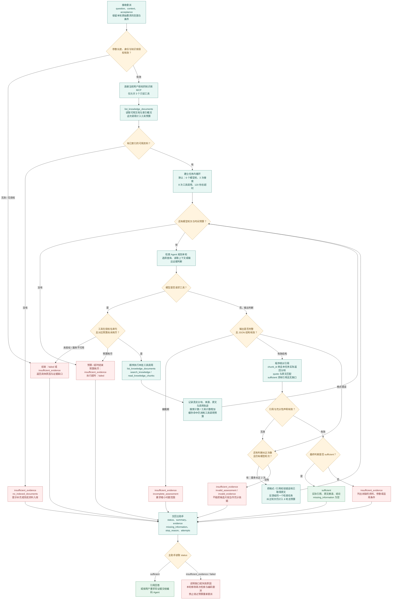
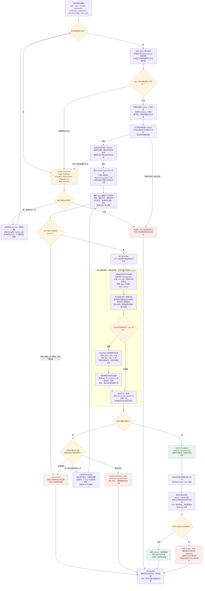
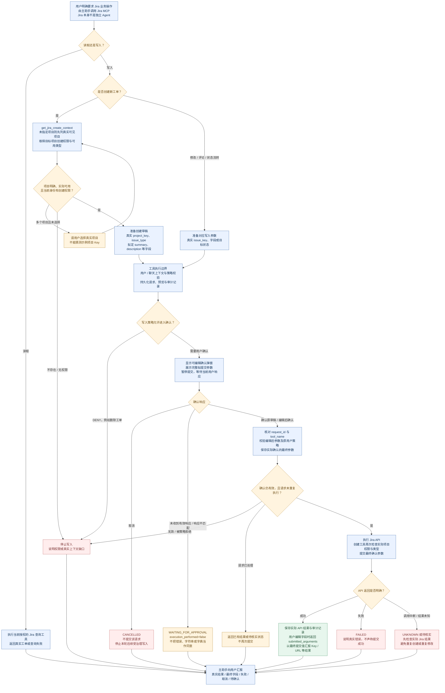

# 当前多 Agent 协作流程

核对日期：2026-10-04。以下图示描述当前代码行为，不把后续规划画成已实现能力。

当前为主助手委派式协作：主助手规划任务，检索 Agent 与编码 Agent 各自在独立任务上下文中执行，再将结构化结果交回主助手。专业 Agent 之间主要通过主助手交接资料和结果。

视觉复核是独立验收模块，不是第四个 Agent；Jira MCP 是业务工具，不是 Jira Agent。图中的路由是任务的逻辑分支，没有另一个专用路由 Agent。同一个需求可以先检索，再编码，最后按用户明确要求执行 Jira 操作。

默认预算来自代码中的 Valves 配置，部署时可配置。图中“验收通过”与“附件交付成功”是不同状态；编码 `completed` 不能替代附件结果检查。

## 图 1：端到端协作与交接



### 交接约定

| 边界 | 传递内容 | 当前约束 |
|---|---|---|
| 用户 → 主助手 | 原始目标、来源要求、产物与后续动作 | 不能因资料编号外形把知识库需求改路由到 Jira |
| 主助手 → 检索 Agent | 完整问题、必要上下文、证据充分条件 | 工具还会保留本轮原始用户需求；不传完整聊天作为任务上下文 |
| 检索 Agent → 主助手 | 充分性判断、实际引用、缺口、停止原因、预算使用 | 原文只是资料，不能授权代码修改或 Jira 写入；引用校验不等于事实认证 |
| 主助手 → 编码 Agent | 明确任务、实际项目目录、证据及适用条件、验收要求 | 资料依赖任务须先取得充分证据；程序测试与网页预览入口按任务提供 |
| 编码 Agent → 独立验收 | SDK 结果、实际项目文件 | 验收独立执行固定命令、读取真实文件、取得真实截图 |
| 编码工具 → 主助手 | 执行状态、工具记录、真实改动、验收报告、附件结果 | 只有 `completed` 且 `verification.passed=true` 才可报告编码通过；附件错误另行披露 |
| 主助手 → Jira 工具 | 真实项目上下文及操作参数 | 受治理写入需要用户确认；不能以聊天里的同意代替确认弹窗 |

## 图 2：检索 Agent 的证据循环



检索最多进行 3 次 `search_knowledge` 搜索，不等于只能读取 3 个分块。`read_knowledge_chunks` 等调用独立计入 8 次工具预算。模型格式 / 引用纠正不会额外增加 6 轮上限。120 秒包括本次任务的连接与执行；超时或模型 / 连接故障按执行失败处理。

检索的引用校验约束“引用必须来自实际取得的原文”，仍不能证明原文自身正确，也不能保证模型的全部推理正确。

## 图 3：编码 Agent、独立验收与交付



### 编码流程的具体边界

- 参数纠错与验收修复分别计数。参数最多纠正 2 次；默认验收修复最多 2 次，对应首次验收加两次修复后的验收，共最多 3 轮。
- SDK 默认 `MAX_TURNS=20`，任务执行超时默认 600 秒。修复不会绕过 SDK 轮次错误或重置整次执行超时。当前 SDK 执行超时不包含取得工作区锁前的排队时间。
- 进程内锁按 `terminal_id` 共享，不是分布式锁，也没有多机并发调度器。它主要防止当前进程中的同一终端编码任务互相改写文件。
- 锁与 `realpath` 检查确认任务工作目录边界；它们不是对任意 shell 命令的完整操作系统级隔离。命令运行仍依赖 OpenTerminal 的执行环境与用户授权。
- 验收器是顺序执行的：文件检查 → 固定命令 → 浏览器 / 视觉检查 → 文件一致性检查。图中没有并行投票或 Agent 互相讨论。
- 代码修改需要可执行验收；前端项目可能同时需要测试与截图。纯 HTML/SVG 绘图用 `verification_commands=[]`，由文件、浏览器与视觉检查验收，不用 `test`、`ls`、`echo` 替代。
- 纯只读分析与文档修改按任务要求检查，不强制运行代码测试。`read_only=true` 仍会核对文件是否实际被修改。
- 本地 HTML/SVG 入口核对源文件 SHA256。HTTP 入口检查运行页面，不能用这个机制宣称已完整证明运行服务与全部代码来源一致。
- SVG 以图片形式渲染与预览，不将其作为活动脚本文档运行。视觉验收不能保证主观美感，也不能代替点击、输入等交互功能测试。
- 自动原件附件当前主要面向 HTML/SVG；其他程序文件不因此自动全部打包为附件。附件生成错误记录为 `delivery_errors`，与编码验收结果分开。
- 当前失败会由主助手据实际报告停止；失败后的文件改动不会自动回滚。

## 图 4：Jira 真实上下文、可编辑确认与提交



Jira 写入确认是当前受治理写入的专门边界，不代表项目全部工具调用都需要强审批。读取与其他允许的工具有不同策略。确认事件匹配、参数持久化、重复执行检查与用户取消约束由工具中间件处理；创建权限和项目类型由 Jira 客户端再次核验。

用户编辑确认字段后，主助手应依据工具返回的 `submitted_arguments` 汇报最终内容；未编辑时按实际确认草稿与 API 结果汇报。确认完成不等于 Jira API 已提交成功。旧请求的结果未核实时不能盲目重复，新一轮用户请求则需要新的确认。

## 当前实现映射

| 图中职责 | 源文件 |
|---|---|
| 主助手提示、工具过滤、当轮停止边界、结果预览 | [`supervisor/native_pipe.py`](../supervisor/native_pipe.py) |
| 检索连接授权、检索循环、预算、引用校验 | [`supervisor/retrieval_tool.py`](../supervisor/retrieval_tool.py) |
| 编码参数、终端授权、工作区锁、SDK 会话、结果状态 | [`supervisor/coding_tool.py`](../supervisor/coding_tool.py) |
| 固定命令、文件快照、截图与视觉复核、同会话修复 | [`supervisor/verification.py`](../supervisor/verification.py) |
| 浏览器渲染、桌面与手机截图、SVG 图片包装 | [`verification_browser/server.py`](../verification_browser/server.py) |
| HTML/SVG 原件、附件、哈希和预览 | [`supervisor/artifacts.py`](../supervisor/artifacts.py) |
| 用户可编辑确认、参数约束与事件校验 | [`governance/confirmation.py`](../governance/confirmation.py) |
| 写入策略、确认结果、重复请求与审计 | [`governance/tool_middleware.py`](../governance/tool_middleware.py) |
| Jira 创建上下文、权限、类型与实际 API | [`lab/jira-mcp/jira_client.py`](../lab/jira-mcp/jira_client.py) |
| 当前 Jira 写入规则与删除拒绝规则 | [`policies/jira-workflow.yaml`](../policies/jira-workflow.yaml) |

## 维护与导出

四张图分别维护：总流程、检索细节、编码细节、Jira 细节。节点 ID 按 `R`、`C/V/D`、`J` 区分职责，便于修改后核对引用和流程边。

更改预算、工具授权、状态语义、确认行为或附件交付时，先对照对应实现更新图中的判断与停止分支，再更新录屏材料。不要只改数字，而保留已经不成立的路径。

可用支持 Mermaid 的 Markdown 预览查看图示，或将每个 `mermaid` 代码块单独保存为 `.mmd` 后通过 Mermaid CLI 导出 SVG。例如在已经安装 Mermaid CLI 的环境中运行：

```text
mmdc -i flow.mmd -o flow.svg -b transparent
```

此命令只是可选导出方式；文档本身不执行任务、不调用模型、不创建 Jira 工单。
