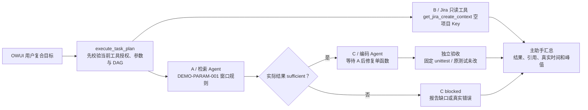

# 在 OWUI 中演示真实并发、依赖等待与编码验收

> 当前录制仅演示鹈鹕骑车，见 [单场景预制演示](pelican-demo.md)。本文保留真实并发和代码修复案例作为技术评审备用。

本演示围绕一个小而完整的开发任务：依据知识库中的虚构规范，修复窗口大小校验函数并运行固定测试；同时进行与代码无关的 Jira 项目只读查询。全部任务从真实 Open WebUI“协作助手”聊天发起，进度使用 OWUI 原生状态历史，结果使用真实工具与验收记录。状态按节点多行显示，文字对比度已增强；节点改变立即更新，等待期间约 5 秒刷新一次真实快照。辅助讲解卡不是执行舞台。

选择小任务是为了减少不必要的上下文、文件遍历、模型输出和视觉验收成本。演示不跳过独立验收，不注入虚假结果，也不保证固定响应秒数。

## 角色与任务实例

| 角色或模块 | 本轮职责 |
|---|---|
| 主助手 | 理解复合目标、调用任务编排器、解释证据和最终结果。 |
| 检索 Agent | 独立上下文中的知识搜索与原文核对，输出证据充分性和引用。 |
| 编码 Agent | Claude Agent SDK 执行会话；在用户授权的 OpenTerminal 中修改与调试代码。 |
| Jira 工具 | 按当前用户授权进行只读查询；不是第四个 Agent。 |
| `execute_task_plan` | 校验并执行请求内 DAG，管理真实并发与依赖状态；不是新增的业务身份。 |
| 独立验收模块 | 执行固定命令、检查真实退出码和原测试保护，决定代码是否完成。 |

Agent SDK 是执行框架，实际使用的模型由平台配置决定。不能把“使用 Claude Agent SDK”概括为所有环节都使用 Claude 模型。

## 演示任务 DAG



A 与 B 同时具备运行条件；C 只依赖 A。B 查询结果不用于代码实现，B 的失败不应阻断与它无关的 C。检索不足或失败会阻断 C。最终汇总等待所有本计划任务达到实际终态，但不会要求每条分支都成功后才解释结果。

“并发”需要由实际任务运行区间重叠与真实并发峰值证明。主助手同一轮提出多个工具调用，或多个进度卡片同时出现在页面上，不足以单独证明并发。

## 编排边界与权限

任务参数格式：

```json
{
  "tasks": [
    {
      "id": "A",
      "title": "简短任务标题",
      "tool": "当前已授权工具的真实完整名称",
      "arguments": {},
      "depends_on": []
    }
  ]
}
```

- 每个请求最多 6 个任务，最多 3 个并发。
- 每个计划最多一次检索委派和一次编码委派，避免拆分任务绕过专业 Agent 预算。
- 所有工具必须来自当前用户已授权、已经过治理包装的工具集合；计划不新增权限。
- 工具完整名称以当前 OWUI 提供的名称为准；连接前缀不能靠猜测。
- 有效 DAG 才能开始执行；缺失依赖、循环、自依赖、未知工具及非法参数应在执行前拒绝。
- 需要知识依据的编码任务必须依赖相应检索任务，真实依赖结果会加入编码上下文。
- 计划内仅允许已准入的检索、编码和只读业务工具，不包含 Jira 写入或嵌套计划。
- Jira 写入仍使用既有权限检查和人工可编辑确认，不借并发编排绕过确认。

当前是请求内调度，不是跨服务任务队列或重启后恢复系统。编码仍遵守终端工作区锁：同一工作区不能因为提高计划并发数就允许多个任务同时写入。一个计划只安排一个编码节点，也不会把任务并发能力夸大为多个编码 Agent 同时修改同一项目。

## 固定小样例

在仓库根目录准备已授权演示用户的专用样例：

```powershell
docker compose -f lab/docker-compose.yml exec -T open-webui python -m supervisor.prepare_demo_live --reset
```

脚本负责创建并标记 `demo-live`，并上传或复用 [当前现场规范](fixtures/demo-param-001.md)、确认索引就绪；当前演示环境该资料已经上传。

`--reset` 只重置已标记的演示目录，不重置任意用户目录。准备成功不表示 Agent 已执行或验收成功。每次需要展示修复行为时，先重新准备初始样例，避免把已经修好的文件当作一次新实现。

| 项目 | 内容 |
|---|---|
| 编码目录 | `repo="demo-live"`，位于当前用户 OpenTerminal 工作区内 |
| 实现文件 | `demo_window_validator.py` |
| 固定测试文件 | `test_demo_window_validator.py`，不可修改 |
| 函数 | `validate_window_size(value)` |
| 行为 | 仅接受非布尔整数，64–4096（含边界）、2 的幂；合法返回原整数，否则抛 `ValueError` |
| 验收命令 | `python -m unittest -v test_demo_window_validator` |
| 预览参数 | `preview_target=""`，不调用浏览器和视觉模型 |
| 依赖 | 仅 Python 标准库 |
| 验收输入 | 3 个测试方法，覆盖 13 个子输入 |

13 个子输入由合法值 `64/256/4096`，非法类型 `True/False/256.0/"256"/None`，非法范围或非幂 `0/63/100/4097/8192` 组成。unittest 的测试方法数量是 3，不能将其报告成 13 个独立测试方法。

只修改既有实现，保留原测试。验收运行指定模块，避免发现整个用户工作区中的无关测试。将专用两文件样例作为项目范围，也减少无关文件快照、搜索和工具调用。真实失败仍进入既有有限修复闭环，验收耗尽则报告未完成。

## 现场录屏顺序

1. 检查准备脚本返回的知识状态为 ready，打开知识库核对当前现场 `DEMO-PARAM-001.md`；其源码是 [docs/fixtures/demo-param-001.md](fixtures/demo-param-001.md)。当前环境已经上传，重新部署可由准备脚本入库；旧完整三字段资料仅为备用。窗口规则来自虚构资料，不能证明真实设备误报率。
2. 预检知识检索和 Jira 只读授权，准备样例，然后在新 OWUI 对话发送主案例计划。
3. 展开原生状态历史，观察 A/B 运行和 C 等待依赖；观察 A 充分证据完成后 C 启动。
4. 展示最终任务表中的真实状态、时间与并发峰值，展开编码固定测试命令、退出码和独立验收。
5. 新对话询问“threshold=0.65 是否保证任意设备误报率低于 1%”，展示没有证据时停止编码。
6. 回到主案例同一对话，只读复盘已有结果，不重新执行。

主案例应包含节点等待、真实并发和独立验收。若外部 Jira 服务不可用，可采用无检索的单函数编码备用，但应说明备用只验证编码与验收，不证明本轮主案例的并发结果。天气服务依赖外部数据，本轮不作为稳定性要求较高的主案例分支。

录制约 6–8 分钟，先用预演实际耗时决定剪辑节奏。等待加速、提前录制片段与历史结果在画面中标注。

## 如何判断演示通过

| 维度 | 可核对的实际证据 |
|---|---|
| 权限 | 任务工具来自本用户授权集合，计划没有触发 Jira 写入。 |
| 并发 | A/B 运行区间重叠，计划记录的真实并发峰值至少为 2。 |
| 依赖 | C 不早于 A 充分证据完成；不等待无关 B。 |
| 资料 | 实际文件名与分块引用；没有编造页码或性能结论。 |
| 编码 | 修改范围为专用实现；固定测试保持不变。 |
| 验收 | 指定命令真实执行、非空测试集合、退出码 0、独立验收通过。 |
| 失败 | 不足、拒绝、超时和验收耗尽都有真实终态；不拿历史成功冒充当前结果。 |

## 验收强度与工作区等待

程序任务继续执行真实测试、原测试保护和文件一致性检查。小型网页/SVG 的视觉复核只依据用户明确要求和实际可用性；未要求的画风、配色和可选美化放入非阻塞 `suggestions`，不作为失败理由。明确内容缺失、空白、裁切、手机不可用及功能要求未验证仍会阻塞通过。

编码工作区锁默认最多等待 30 秒（`WORKSPACE_WAIT_SECONDS`）。占用到期返回 `workspace_busy`、`execution_started=false`；SDK 和验收没有启动，也不取消当前持锁任务。默认 600 秒 SDK＋验收＋修复预算不含这段排队，任务计划另有请求整体截止。录制前检查自己的其他编码会话是否仍运行，不靠跳过锁来缩短等待。

首轮真实预演存在工作区争用。下面的数字属于加入 30 秒排队上限前的一次记录，不代表空闲状态性能或稳定性统计：

| 首轮实测项目 | 实际记录 |
|---|---|
| OWUI 请求墙钟时间 | 320.325 秒 |
| 计划执行 | 约 299.7 秒，实际并发峰值 2 |
| A 检索 / B Jira 只读 | 约 13.8 秒 / 2.3 秒 |
| C 编码任务总时长 | 约 285.9 秒 |
| C 工作区排队 | 约 248.5 秒 |
| SDK 启动 | 约 0.4 秒，包含在 SDK＋验收区间中 |
| SDK＋独立验收 | 约 37.1 秒 |
| 固定测试与保护 | 3 方法、13 子输入通过；原测试 SHA256 未变 |

该次耗时主要来自排队，不能归因为验收太慢。各时间包含关系不能直接相加。

速度继续拆开衡量，而不是只看一条聊天总耗时：

| 指标 | 当前数值 |
|---|---|
| 从实际 OWUI 输入框提交到首个可见状态 | 0.79 秒 |
| 输入到最终结果可见 | 78.59 秒 |
| A 检索 / B Jira 只读 | 27.65 秒 / 1.01 秒 |
| C 编码整体 / 锁等待 | 33.04 秒 / 0.00004 秒 |
| SDK 启动 / Agent 执行 | 0.70 秒 / 31.76 秒 |
| 独立验收 | 0.203 秒，固定测试、前后快照；无浏览器或视觉调用 |
| 计划总用时 / 实际并发峰值 | 60.74 秒 / 2 |
| 固定测试与原件保护 | 3 方法、13 子输入通过；实际读取测试 SHA256 一致 |
| 长期成功率 | 未统计；这两次记录不足以推导成功率 |

第二轮通过真实 OWUI 输入框提交本地准备的主问题，浏览器观察到依赖等待和验收结果，页面无脚本错误。A/B 的执行区间实际重叠；C 在 A 结束后约 7 毫秒开始，未依赖 B。仅实现文件发生变更，原固定测试未改。这一轮的独立验收仅约 0.2 秒，主要执行耗时来自模型推理。

可以直接复制的完整问题见 [OWUI 演示问题](owui-demo-prompts.md)。这些记录不代表已完成稳定性统计。固定范围与预检能减少不确定性，但模型推理、授权服务与外部网络仍有变化，不能保证固定秒数或每次都成功。
