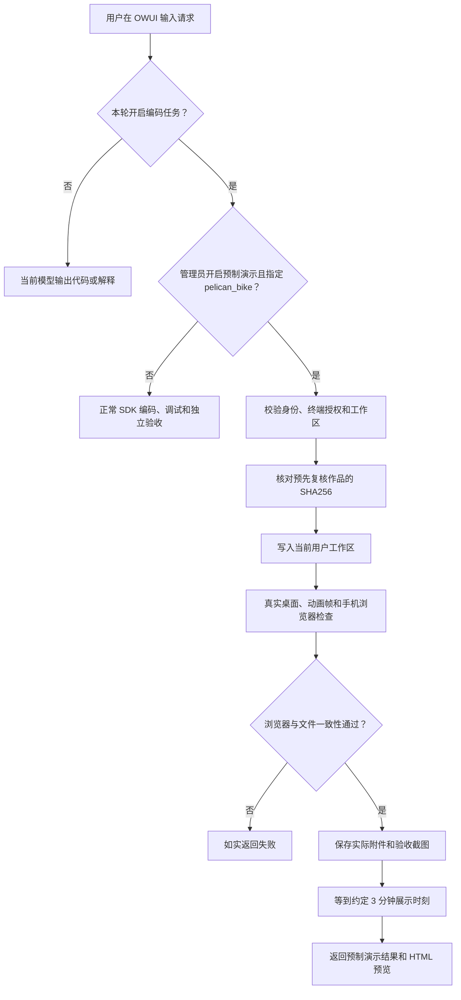

# OWUI 鹈鹕骑车演示

当前录屏只演示一个预制场景：好看的鹈鹕骑车动画。直接在 Open WebUI 的“协作助手”输入问题，开启“编码任务”后调用专用演示入口；正常编码仍使用 Agent SDK。

## 用户选择是否调用编码 Agent

在聊天输入框点击集成按钮（Integrations），进入 Tools，然后点击“编码任务”所在行开启或关闭。旁边的 Available Tools 只列出工具，不是开关。关闭后，主模型仍能解释代码、输出完整 HTML；它不能声称自己已经写入工作区、运行测试或生成附件。开启后，平台才能委派编码任务。切换模型可能恢复该模型的默认工具选项，发送前再看一眼。

SDK 是执行框架，模型由配置决定，并不要求所有代码都交给 Claude 模型。专用演示不调用 SDK，也不把预制作品说成模型现场创作。

## 直接复制这一个问题

> 请演示预制的“鹈鹕骑车”动态图：使用已开启的编码任务工具，选择 pelican_bike 演示场景，提供 HTML 附件和可打开的预览。不要现场重新创作，也不要增加其他任务。

演示包含海岸场景、鹈鹕、自行车、同步踩踏与车轮、围巾摆动和眨眼。作品使用单文件 HTML/CSS/SVG，无外部资源，支持桌面、手机及减少动态效果设置。

当前版本已去掉画面上的中英文标题和文案，取消大阴影与光晕，采用较简单的卡通配色。


上面这一条完整提示词匹配专用固定入口，主助手直接返回正常的 OWUI 原生工具调用，避免模型规划漏传字段或增加步骤。当前授权工具仍由 OWUI 执行；关闭工具时固定入口不可用。改写问题或增加新的需求会交给模型正常规划，不强行套用这幅作品。

## 真实执行流程



3 分钟从编码工具开始计算，固定入口免去初始模型规划和最后总结两轮调用。资源空闲、浏览器服务正常时，工具在约 3 分钟返回。真实检查耗时超过展示窗口时，不跳过检查，也不伪称按时成功。界面倒计时说明作品已检查、正在等待展示时刻，不模拟 Agent 正在写代码。

作品录制前经过实际浏览器截图与主体布局复核，记录源文件哈希。每次现场运行重新检查同一作品的哈希、实际页面加载、横向溢出、三张截图和交付一致性。普通网页任务仍执行原有的视觉验收与修复流程。

## 部署与关闭

在仓库根目录执行：

```powershell
docker compose -f lab/docker-compose.yml exec -T open-webui python -m supervisor.register
docker compose -f lab/docker-compose.yml exec -T open-webui python -m supervisor.configure_pelican_demo --enable
```

现有实例完成任务后重启 `open-webui`，再刷新 OWUI，让已缓存的工具和 Pipe 加载新配置。新安装默认关闭专用演示。关闭命令：

```powershell
docker compose -f lab/docker-compose.yml exec -T open-webui python -m supervisor.configure_pelican_demo --disable
```

## 录制时这样说

“这里由用户选择工具。没有开启编码工具时，聊天模型可以直接提供代码；开启后才把执行任务交给编码模块。这次使用预先准备并复核过的动画，展示授权、工作区交付、真实浏览器检查和 OWUI 预览，约 3 分钟返回。它展示的是平台流程，不代表 Claude 在这段时间内从零完成这幅画。”

既有并发检索、依赖等待和真实代码修复案例保留在 [OWUI 现场演示资料](owui-live-demo.md)，作为技术评审备用。
