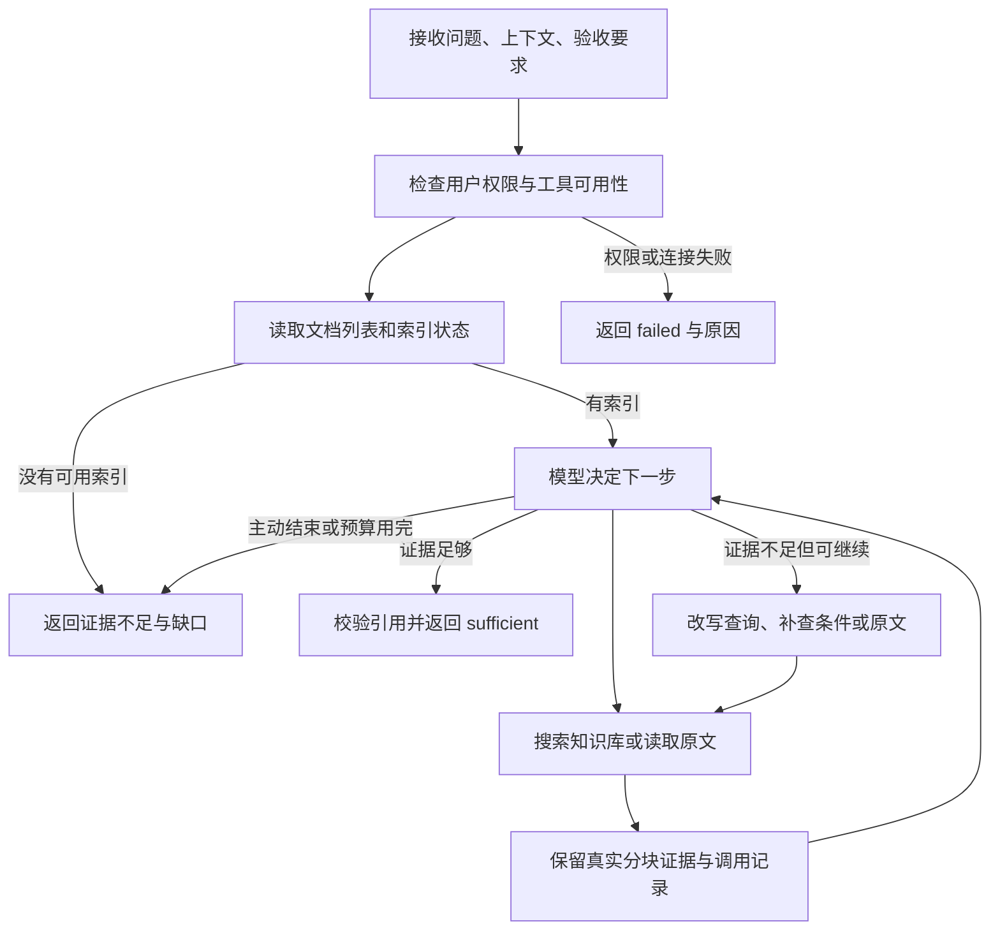

# 独立检索 Agent 设计

目标是让 **OWUI 规划，检索 Agent 管理查资料，Claude Agent SDK 管理编码**。
检索 Agent 自己决定如何查、是否补查和什么时候停止；OWUI 接收检索结论后安排下一步。
当前只使用 ragflow 的向量检索与原文读取，不接入知识图谱。

## 接入方式

主助手看到一个任务工具：

```python
delegate_retrieval_task(question, context="", acceptance="")
```

- `question`：要回答的问题。
- `context`：与问题有关的业务背景、已知约束或已有线索。
- `acceptance`：怎样才算检索足够，例如必须找到参数值、单位和适用条件，并给出原文引用。

注册脚本把本地 `retrieval_agent` 工具绑定到 `owui-main`。ragflow MCP 连接继续保留在
OWUI 的工具连接中，并受当前用户权限控制；主助手的工具列表移除底层三项 ragflow 工具，
由检索 Agent 在授权检查后使用。凭据仍由 OWUI 管理，不作为任务参数交给模型。

刷新页面后，新对话选择 **协作助手**（`owui-main`），这是唯一保留的 Pipe 入口。
旧 `owui_supervisor` 聊天的模型引用迁移到同一入口，正文保持不变。
用户说明来源为知识库或 ragflow 时，编号即检索线索；形似工单号不构成 Jira 路由依据，
检索工具不可用也不回退到 Jira。

Agent 使用独立的 AsyncAnthropic 模型与工具循环，运行在现有 OWUI 后端。
它有自己的任务消息历史、可用工具和预算，不需要新增容器、数据库或本地模型。
“独立 Agent”指独立推理与执行上下文，不要求独立部署进程。

## 检索循环



每次搜索后，模型根据问题和验收要求检查证据：是否直接回答问题，是否包含单位、条件和
限制，是否存在冲突，是否需要读取相邻分块。资料不足时可以换关键词或更聚焦的问题补查。
这里的充分性判断由模型做，调用次数、超时、重复查询和引用来源由代码约束。

## 工具与预算

| 项目 | 默认范围 |
| --- | --- |
| 检索来源 | 当前用户授权的 ragflow MCP 连接 |
| 可用工具 | `search_knowledge`、`list_knowledge_documents`、`read_knowledge_chunks` |
| 模型轮数 | 最多 6 轮 |
| 搜索次数 | 最多 3 次 |
| 工具调用 | 最多 8 次 |
| 原文读取 | Agent 每次最多 6 个片段；底层 MCP 的单次上限仍为 50 |
| 最终输出修正 | 格式或引用校验失败时，最多反馈修正 2 次，仍计入原有模型轮数预算 |
| 单任务时间 | 最多 120 秒 |
| 重复查询 | 抑制重复搜索，要求修改查询策略 |

检索 Agent 不获得终端、Jira 写入、上传、删除文档或修改配置工具。
超出预算就停止，返回已有证据、停止原因与缺失信息，不能无限重试。
远程错误会作为观察结果进入受限循环或失败结果；没有有效证据时不会伪造一个成功答案。

## 结果契约

| 字段 | 含义 |
| --- | --- |
| `status` | `sufficient`、`insufficient_evidence` 或 `failed` |
| `summary` | 针对问题的结论或当前进展 |
| `evidence` | 实际返回的分块及引用：分块 ID、文档 ID、文件名、页码、原文、摘录、引用标识等 |
| `stop_reason` | 充分性判断、主动结束、预算耗尽、超时或错误等停止原因 |
| `attempts` | 实际模型轮数、搜索次数和工具调用次数 |
| `tool_evidence` | 实际调用记录：工具名、参数、状态、结果数量和分块 ID；查询重试过程可由这些记录核对 |
| `missing_information` | 尚未找到的关键条件、参数或资料 |

`evidence` 中的引用必须能够对应到工具实际返回的分块。模型输出中无对应来源的引用
不被接受；`quote` 必须是对应分块原文的子串，原文与文件、页码等元数据以工具结果为准。
无有效证据不能返回充分。
PDF 页码来自提取过程，DOCX 不编造页码。

若最终 JSON 格式或引用校验失败，Runner 把失败原因及已取得的真实分块 ID、原文反馈给模型，
允许其在原有 6 轮预算内最多修正两次。修正后的摘录仍须逐字匹配原文，不能降低引用标准。
证据不足且模型未列出缺口时，保留其不足说明作为缺失信息。

检索相似度表示文本相关性，`sufficient` 表示在当前任务、资料和预算内判断证据够用。
两者都不是论文质量评定或科学结论认证。若来源只是虚构演示文档，结果仍须保留这个限制。

## 主助手怎样消费结果

主助手继续拥有全局任务目标和下一步决定权：

- 收到 `sufficient`：结合引用回答，或将证据和约束交给编码 Agent。
- 收到 `insufficient_evidence`：报告缺失信息；需要用户补文档或澄清时明确指出。
- 收到 `failed`：说明连接、权限或执行错误，避免把失败包装成“知识库没有答案”。

例如用户要求“根据资料实现一个频谱感知程序并测试”，主助手先委派检索，
收到参数、方法与限制后再委派编码。编码 Agent 自己处理实现和测试，结果回到主助手汇总。
当前没有专业 Agent 相互调用：调度与上下文交接都经过主助手，任务所有者清晰。

主助手还会检查本用户轮中实际的检索委派调用及结果。结果为证据不足或失败后，
本轮从实际执行工具映射中移除编码委派和再次检索委派，结束当前委派链并报告缺口，
避免忽略不足结果继续写代码。该限制只作用于当前用户轮；用户下一轮补资料或给出新任务时
重新评估，不沿用旧失败。检索 Agent 自己的查询重试仍在本次委派内部完成。

## 安全与当前边界

文档内容作为不可信资料进入模型；文档中的命令、提交要求或“用户已批准”等文字不能
授权后续操作。检索只读，写入动作仍由用户目标、工具权限和既有治理决定。
Jira 写入继续走预览与人工确认；Git、任意 shell 或发布尚未接入统一的强制审批门。

当前没有知识图谱、关键词/向量混合检索、重排、多知识库并行、后台任务或重启续跑。
检索 Agent 的独立审查步骤是证据核对；没有再增加第四个审核 Agent。

## 验证入口

在 `lab` 目录执行：

```powershell
docker compose exec -T open-webui python -m unittest tests.test_retrieval_agent tests.test_supervisor
docker compose exec -T open-webui python /lab/retrieval_lab/smoke_test.py
docker compose exec -T open-webui python /lab/supervisor/smoke_agents.py
```

本轮 90 项完整回归测试全部通过，其中独立检索与主助手 43 项（检索 33 项，主助手 10 项），
包含引用修正和不足阻断机制。
真实集成已验证
底层入库、百炼向量化、三个 MCP 工具和 OWUI 委派检索 Agent，最终回答含准确演示参数
与分块引用，并保留虚构资料限制。证据不足时，真实检索 Agent 也完成了改写为两个不同查询、
3 轮模型请求、4 次工具调用后主动返回不足的验证。

本轮 `smoke_agents.py` 从 `/api/models` 读取实际完整工具配置并全部通过：主助手先委派检索，
再将真实文件名、参数和演示限制交给编码
Agent；编码完成后，OpenTerminal 独立重跑两项测试通过，确认采样率 `2e6`、阈值 `0.12`
及 `IS_DEMO=True`。负向场景中，检索明确缺少通用公式和真实性能，主助手报告缺口并停止，
未调用编码 Agent。测试未执行 commit、push 或 Jira 写入。
该示例只生成保存演示参数常量的模块，验证跨 Agent 证据交接，没有实现实际频谱感知算法。

验证的工具列表包含 Jira 等业务工具。清理前的兼容入口知识库查询只调用检索委派，取得准确演示参数
与原文引用；主入口正向和负向通路均通过，三个场景都没有 Jira 调用。
正向检索经过 3 轮模型请求、1 次搜索、3 次工具调用返回充分，随后完成编码任务。

在 **协作助手** 可复制：

```text
查 ragflow 中 SS-TEST-042 的采样率和阈值并附原文引用。证据足够后，
委派编码 Agent 在当前工作区新目录生成演示参数模块、标记演示数据，
写至少两个单元测试并运行，不提交。
```
